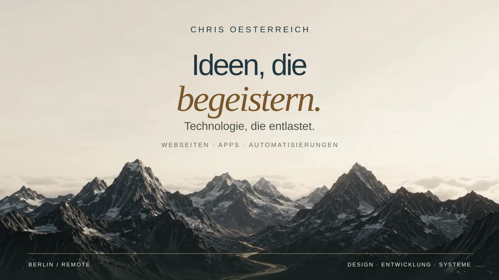
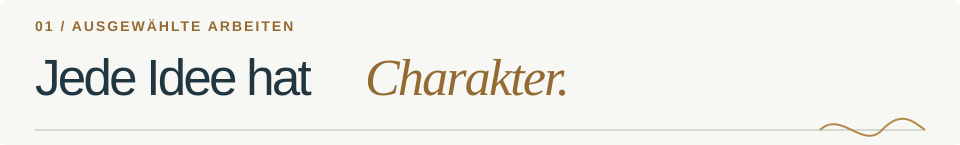
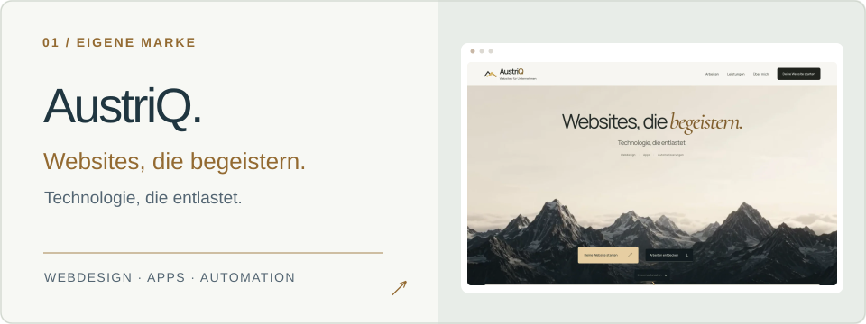
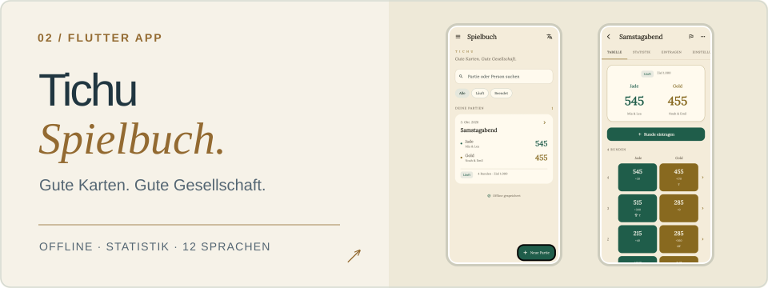
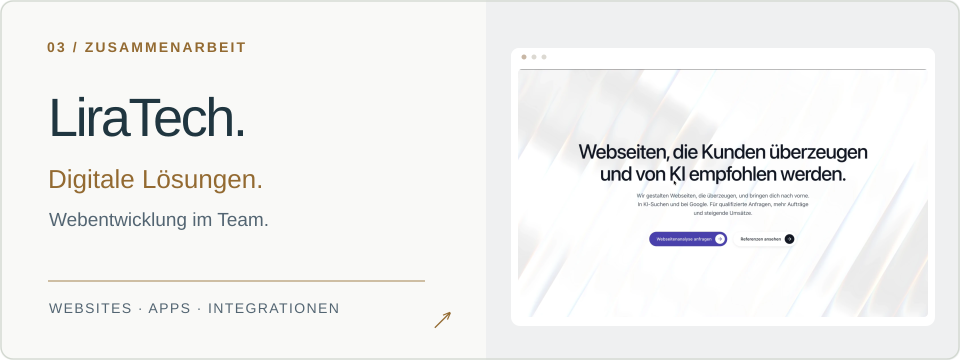
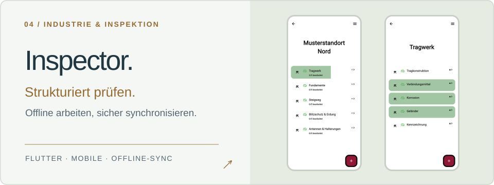
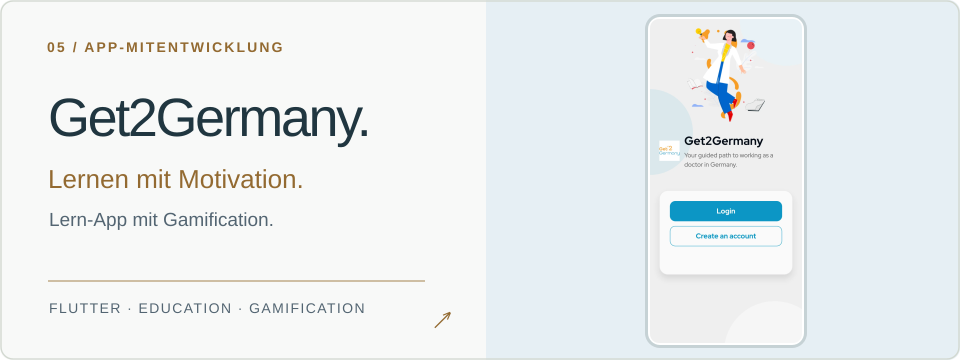
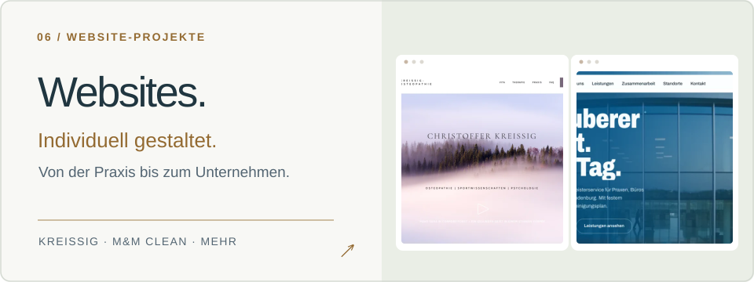
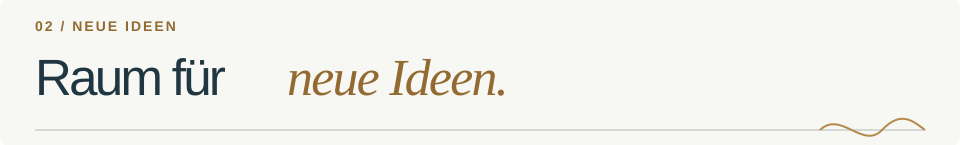
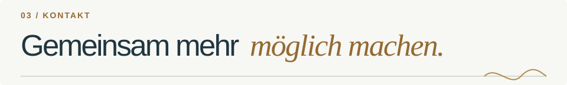

<!-- Profil von Chris Oesterreich · Design inspiriert von austriq.de -->

  

  <strong>Softwareentwickler · Gründer von AustriQ · Zusammenarbeit mit LiraTech</strong>

  Ich gestalte und entwickle individuelle Websites, Apps und Automatisierungen. 
  Mit einem Blick für Gestaltung und Freude an Technik, die im Alltag wirklich hilft.

  <a href="https://austriq.de/">AustriQ ↗</a> &nbsp; · &nbsp;
  <a href="https://www.liratech.de/">LiraTech ↗</a> &nbsp; · &nbsp;
  <a href="mailto:kontakt@austriq.de">Kontakt ↗</a>

 

Ausgewählte Arbeiten und echte Projektaufnahmen. Tichu Spielbuch ist in Entwicklung; M&amp;M clean ist ein Relaunch-Entwurf. Ein Teil der Webprojekte entsteht gemeinsam mit LiraTech.

  

**Warung Idle** — ein Bali-inspiriertes Idle-Aufbauspiel mit Web- und Flutter-Version.  
**LaserWars** — ein experimentelles Strategiespiel auf Basis von Flutter und Flame.  
**Automatisierung &amp; Integration** — n8n-Workflows, APIs, Browser- und Desktop-Automation.

**Tech Stack:** Flutter · Dart · JavaScript / TypeScript · Python · Node.js · n8n · Docker · PostgreSQL · Google Cloud · Terraform

Mein Ausgangspunkt ist Berlin. Ich arbeite auch remote und mag Projekte, bei denen technische Qualität und gutes Design zusammenkommen.

 

  Du hast eine Idee für eine Website, eine App oder eine Automatisierung? 
  <a href="mailto:kontakt@austriq.de"><strong>kontakt@austriq.de ↗</strong></a>
  &nbsp; · &nbsp; <a href="https://austriq.de/"><strong>austriq.de ↗</strong></a>

Mit Liebe zum Detail. Von der ersten Idee bis zum funktionierenden Produkt.

